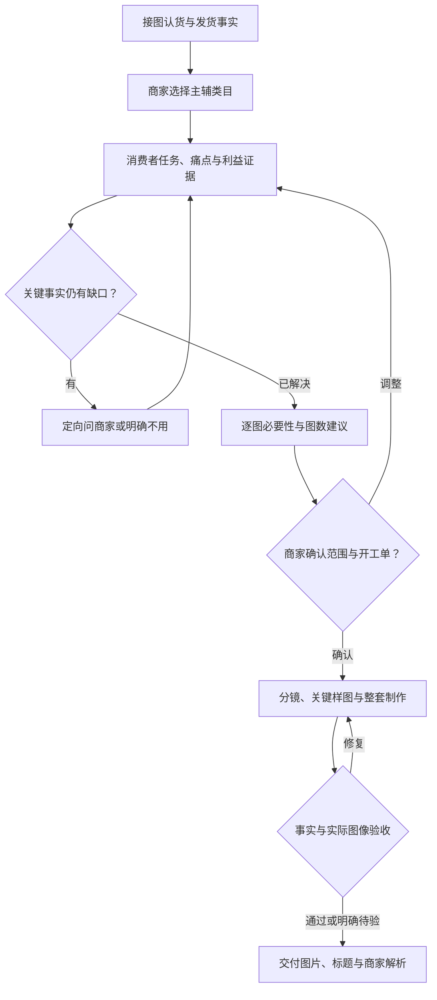

# 商品设计工作流

**版本：v1.0.1 - By Jimmy.yang**

一个通过对话组织电商图片、标题和卖点制作的通用 Agent Skill。输入一张或多张产品照片，先认清商品与真实发货内容，再让商家选择类目；Agent 分析购买任务、主动创造卖点、解释每张图为什么存在，经确认后调用宿主工具制作并验收。

项目适用于多种商品，照明类案例较充分；附带照明类目参考树，其他品类需提供或核实对应类目。**本项目不是平台官方工具，也不附带官方类目接口、官方刊登许可或独立图像生成服务。**

## 核心能力

- **先对话再制作**：类目、关键事实、套数、图数、差异化分支和开工单由商家确认；已有答案不反复问。
- **先需求后图数**：从消费者、使用时机、任务与痛点出发，说明每张图的独立作用与信息增量，再推荐数量。
- **卖点开放、性能真实**：Agent 设计购买理由、场景和营销语言；续航、防水、材质、承重等能力有依据才宣称。
- **具体电商表达**：使用结果全景、部件/操作窗口、功能分层、利益卡片与合适的字体层级；不默认全套白底或统一暗底。
- **多类目、多套图**：同款可以做不同任务的创意，各套分别安排卖点、标题和图位；真实差异款与开发目标分开。
- **数量前置**：主图顶部和最终标题开头必须显示准确件数；单件 `1pc`，确有1/2/4件可选时 `1/2/4pc`。
- **可追溯交付**：每套给图片、最终标题、文案及商家解析，保留事实来源、图位与验收状态。

## 工作流



详细步骤、对话边界与能力降级见 [工作流说明](docs/WORKFLOW.md)。

## 使用方式

### 支持本地 Skill 目录的宿主

将仓库中的 **整个** [skills/ecommerce-product-creative](skills/ecommerce-product-creative/SKILL.md) 文件夹放入宿主支持的个人 Skill 目录，保持 `references/`、`scripts/`、`assets/`、`agents/` 的相对位置。宿主可能要求重新加载或在新对话中使用；以实际宿主的安装方式为准。

不要只复制 `SKILL.md` 而漏掉引用模块。Skill 的主要功能不依赖 Python；可选检查器使用 Python 3.10+ 标准库。图像生成、原图绑定、回看和文件输出由宿主提供。

### 通用 Agent / 聊天环境

将 `SKILL.md` 与相关引用模块作为可读取资料提供给 Agent，并明确要求使用本流程。仅粘贴首页不能保证 Agent 能读取其他模块。若宿主没有读图、生图或原图绑定能力，只能交付已确认事实下的文案/提示词，不能把相似商品当成实际成品。

启动示例：

> 请使用 ecommerce-product-creative，根据这些产品照片制作一套电商图片。先识别商品和真实发货，推荐主辅类目由我选择，再分析消费者、痛点和卖点。解释每张图的作用后推荐数量，等我确认开工单再制作。主图和标题头部都必须有准确件数。

多套示例：

> 同一款产品，我想分别面向三个不同类目制作三套图。请先推荐类目并让我选择，再分别分析需求和图位；不要直接复制第一套的标题、场景和卖点。图数先给依据和建议，我来确认。

更多示例见 [examples/STARTERS.md](examples/STARTERS.md)。

## 数量规则：两处都必须有

| 当前链接真实可售规格 | 标题开头 | 实际主图顶部 |
|---|---|---|
| 只有1件 | `1pc ...` | `1pc ...` |
| 只有2件 | `2pc ...` | `2pc ...` |
| 同链接1、2、4件可选 | `1/2/4pc ...` | `1/2/4pc ...` |
| 另一个链接有其他数量 | 只写本链接选项 | 只写本链接选项 |

`pc` 按确认的主商品计数，不把充电线或场景道具相加。多规格表示可选，不是全部随附。件数未知先问；按 pair/set 售卖且计数有歧义时先确认口径。明确的无字主图要求与该规则冲突时，请商家裁定，Agent 不得偷偷省略。

完整规则见 [quantity.md](skills/ecommerce-product-creative/references/quantity.md)。

## 一次制作会交付什么

每个已确认制作方向单独交付：

1. 对应实际 SKU 的约定图片，以及各图的真实完成/待验状态。
2. **一条最终买家语言标题**及中文核对，头部含准确数量标签。
3. 图内短词、独立卖点与简洁描述，条数按实际证据，不为凑数编造。
4. 中文商家解析：产品与类目、适合谁、什么时候用、痛点与购买理由、为何采用这些图、标题和视觉取舍。
5. 多套任务额外给出各套计数、复用与新增内容、真实差异/开发目标及未解决项。

三套各8张意味着 **24个展示图位**；同图被复用不等于多生成了一张新创意。只委托改一个标题时按单项范围交付，不强迫整套流程。

## 目录

| 路径 | 用途 |
|---|---|
| [skills/ecommerce-product-creative/SKILL.md](skills/ecommerce-product-creative/SKILL.md) | Agent 入口与硬关卡 |
| `skills/ecommerce-product-creative/references/` | 对话、事实、类目需求、件数、视觉、生成、交付与验收 |
| [scripts/check_delivery.py](skills/ecommerce-product-creative/scripts/check_delivery.py) | 可选的声明文本件数检查器 |
| [docs/WORKFLOW.md](docs/WORKFLOW.md) | 人机分工、阶段产物与恢复分支 |
| [docs/RELIABILITY.md](docs/RELIABILITY.md) | 已有验证、局限与项目自评 |
| [docs/TESTING.md](docs/TESTING.md) | 自动检查与人工/Agent 验收用例 |
| [examples/](examples/STARTERS.md) | 启动语、输入清单、件数检查输入与交付示例 |
| [CONTRIBUTING.md](CONTRIBUTING.md) | 贡献与回归要求 |
| [CHANGELOG.md](CHANGELOG.md) | 版本变更 |
| [NOTICE.md](NOTICE.md) | 作者、来源边界与许可状态 |

## 本地检查

在仓库根目录执行：

```bash
python3 -m unittest discover -s tests -v
python3 tools/validate_repo.py
python3 skills/ecommerce-product-creative/scripts/check_delivery.py examples/delivery.json
```

仓库附带 GitHub Actions 配置，提交后运行同样的离线检查，无需图像模型或 API Key。**这些检查验证结构与声明文本，不能验证图片已经正确显示数量、商品保真或转化表现。**

## 可靠性与发布状态

当前适合作为 **有人确认业务选择、有人回看图像的 v1.0 Skill** 使用和分享。对话、分镜、交付和数量约定已贯通，并进行了文本试跑及检查器回归；没有完成跨模型大样本、跨品类实图批量评测，不承诺任意弱模型都稳定服从。

仍需实际回看商品形状、接口、数量、字体边界、人物接触和光效。模型可以漏规则；文字出框也仍可能发生。详见 [项目完整性与可靠性评估](docs/RELIABILITY.md)。

本目录已准备为 GitHub 发布源码，尚未替作者创建或发布远程仓库。文档未附真实商家照片、账号、订单和API密钥。公开前请作者完成 [发布清单](docs/RELEASE_CHECKLIST.md)。

## 归属与许可


项目归属仅在必要说明中保留，文档和实现使用AI辅助。本发布包没有替作者选择或授予开放许可证；许可状态见 [NOTICE.md](NOTICE.md)。如计划以开源许可证授权他人复制、修改与分发，请作者发布前补充所选择的 `LICENSE`。署名不代表 平台 官方背书。
